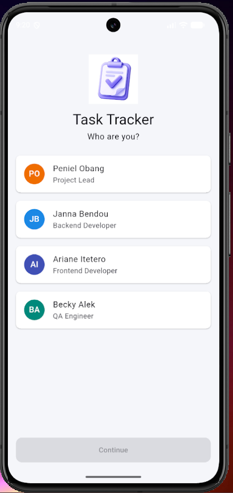
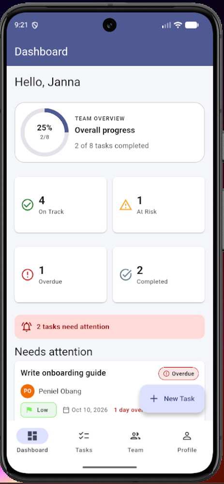
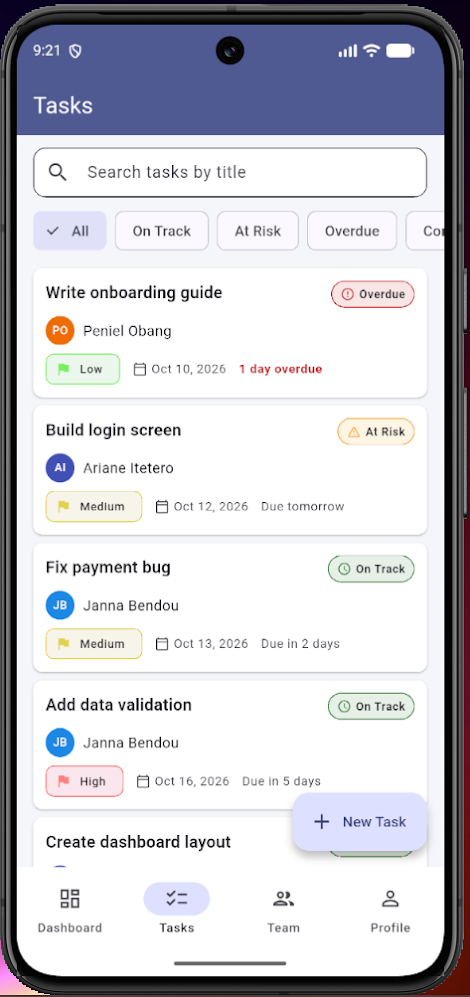
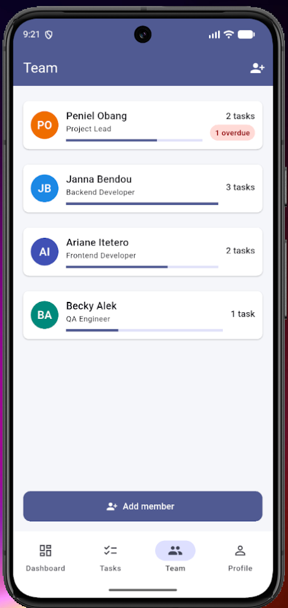
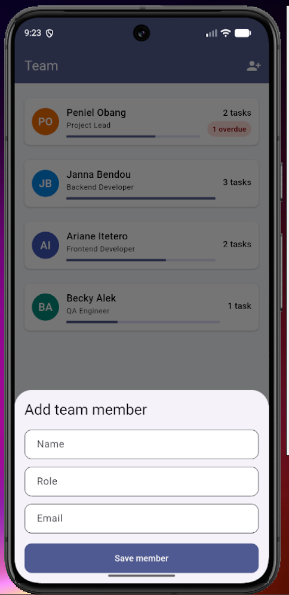
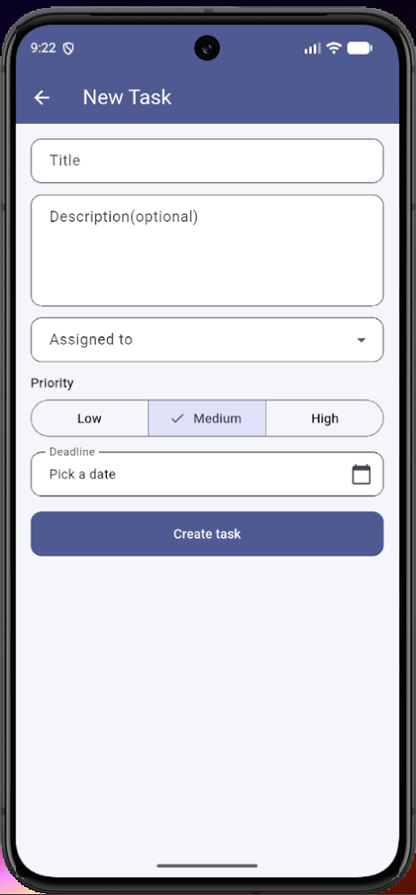
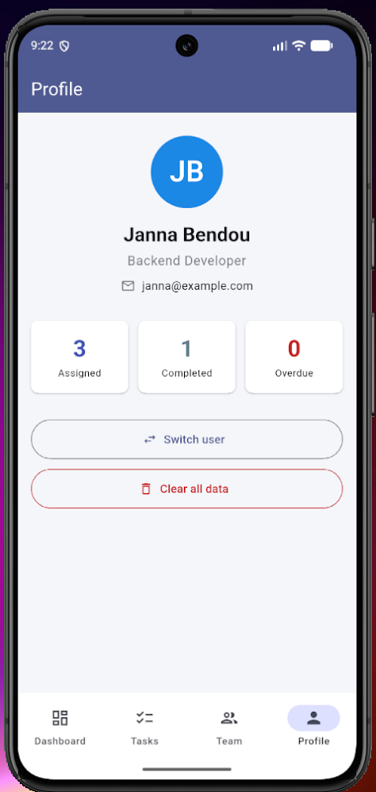

# Project & SLA Task Tracker

We built a Flutter mobile app(Android only) for a small software team to create tasks, assign tasks to members, set priorities and deadlines, and update progress. Our app has eight screens: Sign In, Dashboard, Task List, Task Details, Create/Edit Task, Team Members, Profile, and a Home screen. This application does not have a backend. All the data lives on the device.


> Built for the Mobile Development course, Formative 1 group project (Group 10).

## Screenshots

### Sign In



### Dashboard



### Task List



### Team Members



### Add Team Member



### Create Task



### Profile



## Features

- Pick which team member you are (no real login)
- Create, edit and delete tasks
- Change a task's progress
- Search tasks by title and filter by status or by team member
- See dashboard with overall progress and the tasks that need attention
- Team screen showing each member and their workload
- Form validation with clear error messages
- Data saved on the device between app launches

## SLA status rules

The status is calculated every time a task is shown, using today's date. We never save it, so it can't go out of date.

| Order | Condition | Status |
|---|---|---|
| 1 | The task is marked Done | **Completed** |
| 2 | The deadline day is over and the task is not done | **Overdue** |
| 3 | The deadline is within 48 hours | **At Risk** |
| 4 | High priority, still To Do, and due within 3 days | **At Risk** |
| 5 | None of the above | **On Track** |

The deadline counts until the 23:59:59 of that day, so a task due today is At Risk but not Overdue, until the day is over

## Screens

| Screen | File | Purpose |
|---|---|---|
| Sign In / User Selection | `lib/screens/sign_in_screen.dart` | Choose who you are |
| Home (navigation shell) | `lib/screens/home_shell.dart` | Bottom navigation|
| Dashboard | `lib/screens/dashboard_screen.dart` | Progress and tasks needing attention |
| Task List | `lib/screens/task_list_screen.dart` | Search, filters, swipe to delete |
| Task Details | `lib/screens/task_details_screen.dart` | One task, change its status |
| Create / Edit Task | `lib/screens/task_form_screen.dart` | The task form |
| Team Members | `lib/screens/team_screen.dart` | Members and workload |
| Profile | `lib/screens/profile_screen.dart` | Your details, switch user |

## Project structure and who owns what file

```
Formative1_SLA_task_tracker_Group_10/
|-- pubspec.yaml                         MBeckyAlek
|-- README.md                            arianeitetero
|-- lib/
|   |-- main.dart                        MBeckyAlek
|   |-- app_router.dart                  MBeckyAlek
|   |-- core/
|   |   |-- constants.dart               Peniel-source
|   |   |-- theme/
|   |   |   |-- app_colors.dart          MBeckyAlek
|   |   |   |-- app_theme.dart           MBeckyAlek
|   |   |   |-- app_spacing.dart         MBeckyAlek
|   |   |-- utils/
|   |       |-- validators.dart          Peniel-source
|   |       |-- date_helpers.dart        Peniel-source
|   |-- models/
|   |   |-- enums.dart                   Peniel-source
|   |   |-- task.dart                    Peniel-source
|   |   |-- team_member.dart             Peniel-source
|   |-- services/
|   |   |-- storage_service.dart         Peniel-source
|   |   |-- sla_service.dart             Peniel-source
|   |   |-- seed_data.dart               Peniel-source
|   |-- screens/
|   |   |-- sign_in_screen.dart          MBeckyAlek
|   |   |-- home_shell.dart              MBeckyAlek
|   |   |-- profile_screen.dart          MBeckyAlek
|   |   |-- task_form_screen.dart        Peniel-source
|   |   |-- task_list_screen.dart        bendoujanna
|   |   |-- task_details_screen.dart     bendoujanna
|   |   |-- dashboard_screen.dart        arianeitetero
|   |   |-- team_screen.dart             arianeitetero
|   |-- widgets/
|       |-- member_avatar.dart           MBeckyAlek
|       |-- empty_state.dart             MBeckyAlek
|       |-- sla_badge.dart               bendoujanna
|       |-- priority_chip.dart           bendoujanna
|       |-- task_card.dart               bendoujanna
|       |-- stat_card.dart               arianeitetero
|       |-- progress_ring.dart           arianeitetero
|       |-- section_header.dart          arianeitetero
|-- test/
    |-- sla_service_test.dart            Peniel-source
    |-- validators_test.dart             Peniel-source
```


## Run the app

Requirements: Flutter and an Android emulator or a physical phone.

```bash
git clone <[repository-url](https://github.com/MBeckyAlek/Formative1_SLA_task_tracker_Group_10.git)>
flutter pub get
flutter run
```

To see the Sign In screen again after you have chosen a user, use **Profile → Switch user**, or clear the app's data on the emulator.

## Run the tests

```bash
flutter analyze
flutter test
```

## Team

| Member             | Role | Main contributions |
|--------------------|---|---|
| Becky Alek         | Foundation and navigation | Project setup, theme, routing, Home shell, Sign In, Profile |
| Peniel Nissi Obeng | Data and logic | Models, storage, seed data, SLA logic, validators, task form |
| Bendou Janna    | Task viewing | Task card, Task List, Task Details, member filter |
| Ariane Itetero    | Overview and documentation | Dashboard, Team screen, README, report |
